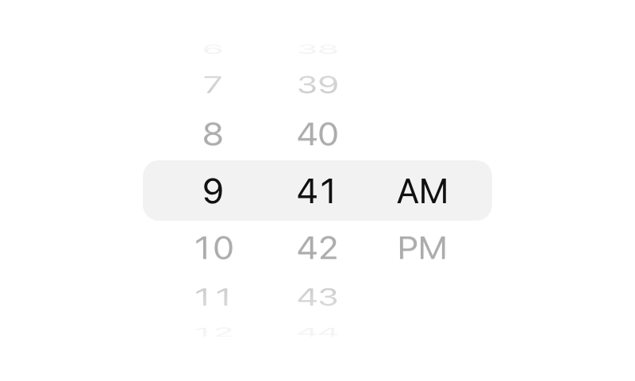

# tambour

[](https://github.com/jordankmars/detent/actions/workflows/ci.yml)
[](./LICENSE)

The iOS scroll-wheel picker for the web, for times, dates or any list.



```tsx
<Tambour.Root value={time} onValueChange={setTime}>
  <Tambour.Wheel items={hours} loop />
  <Tambour.Wheel items={minutes} loop />
  <Tambour.Wheel items={["AM", "PM"]} />
</Tambour.Root>
```

## Install

```sh
npm install tambour
```

Needs React 18 or later.

## What it does

- Momentum is projected from the flick, then snaps to an item. Lists can loop
  or stop at the ends with a rubber-band stretch.
- Rows sit on a 3D cylinder behind a center band.
- Drag, flick, tap an item, mouse wheel, trackpad and keyboard all work.
- Wheels can be linked, so the number of days follows the month.
- Trackpad scrolling stops where your fingers do, and a wheel at its end lets
  the page scroll instead of trapping it.
- Each wheel is exposed to screen readers as a spinbutton with a spoken value.
- Looping lists have no visible seam, and only eleven rows are ever rendered,
  so a list of ten thousand values costs the same as a list of ten.
- Respects `prefers-reduced-motion`.

## React

```tsx
import { Tambour } from "tambour/react";

function TimePicker() {
  const [time, setTime] = useState(["9", "41", "AM"]);

  return (
    <Tambour.Root value={time} onValueChange={setTime} aria-label="Time">
      <Tambour.Wheel items={hours} loop aria-label="Hour" />
      <span>:</span>
      <Tambour.Wheel items={minutes} loop aria-label="Minute" />
      <Tambour.Wheel items={["AM", "PM"]} aria-label="AM or PM" />
    </Tambour.Root>
  );
}
```

No stylesheet to import. It renders the cylinder and center band as is, and
inherits color and font from the page.

### `Tambour.Root`

| Prop            | Type                   | Description                                                          |
| --------------- | ---------------------- | -------------------------------------------------------------------- |
| `value`         | `V[]`                  | The value of each wheel, in the order the wheels appear.             |
| `defaultValue`  | `V[]`                  | Starting values when `value` isn't controlled.                       |
| `onValueChange` | `(value: V[]) => void` | Called as a wheel crosses each item.                                 |
| `onValueCommit` | `(value: V[]) => void` | Called when a change made by the user comes to rest.                 |
| `disabled`      | `boolean`              | Disables every wheel.                                                |
| `itemHeight`    | `number`               | Height of one item in pixels, default 36. Everything scales with it. |
| `reducedMotion` | `boolean`              | Overrides the user's `prefers-reduced-motion` setting.               |

### `Tambour.Wheel`

| Prop         | Type                                    | Description                                                               |
| ------------ | --------------------------------------- | ------------------------------------------------------------------------- |
| `items`      | `T[]`                                   | Strings, numbers, `{ value, label }`, or anything with the readers below. |
| `loop`       | `boolean`                               | Wrap around from the last item to the first.                              |
| `disabled`   | `boolean`                               | Disables this wheel.                                                      |
| `getValue`   | `(item: T) => unknown`                  | The value reported for an item. Defaults to `item.value`, or the item.    |
| `getLabel`   | `(item: T) => string`                   | The text shown and spoken. Defaults to `item.label`, or the value.        |
| `renderItem` | `(item: T, index: number) => ReactNode` | Custom row content. `getLabel` still provides the spoken text.            |
| `index`      | `number`                                | Position in the Root's value. See below.                                  |

Both components forward a ref and any other props to their `div`. Give each
wheel an `aria-label`, since it's what a screen reader announces.

Without `renderItem`, rows are updated outside React and motion costs no
renders. With it, keep the function stable (`useCallback` or module scope) so
rows only render when their item changes.

### Wheel positions

A wheel's position is its order among the Root's `Tambour.Wheel`s, looking
through fragments and plain elements. Separators don't count. A wheel rendered
inside your own component can't be seen from the Root, so give it an `index`.
The same goes for wheels whose parent is a server component. Pass `index` to
every wheel if you pass it to one.

### Linked wheels

Derive the items from the value. If the selected item disappears, the wheel
moves to the nearest one and reports it through `onValueChange`.

```tsx
const [month, day, year] = value;
const days = useMemo(() => daysIn(month, year), [month, year]);

<Tambour.Root value={value} onValueChange={setValue}>
  <Tambour.Wheel items={months} />
  <Tambour.Wheel items={days} />
  <Tambour.Wheel items={years} />
</Tambour.Root>;
```

A controlled wheel follows the parent: changing `value` animates to the new
item, and if the parent ignores or alters a change, the wheel moves to match
when it comes to rest. As with controlled inputs, avoid updating `value` inside
`startTransition`, or the wheel can snap back before the update lands.

### Styling

Default styles have no specificity, so any CSS you write wins.

```css
[data-tambour-band] { background: white; border-radius: 12px; }
[data-tambour-wheel] { flex: none; width: 64px; }
[data-tambour-item] { color: gray; font-size: 18px; }
[data-tambour-item][data-selected] { color: black; }
```

The parts are `data-tambour-root`, `data-tambour-band`, `data-tambour-wheel` and
`data-tambour-item`, plus `data-selected` and `data-disabled`.

Cascade layers, including Tailwind's utilities, can't beat those defaults on
the same property. Set a variable instead, for example
`[--tambour-band-background:white]`:

| Variable                    | Default               |
| --------------------------- | --------------------- |
| `--tambour-gap`              | `2px`                 |
| `--tambour-band-background`  | `currentColor` at 9%  |
| `--tambour-band-radius`      | `10px`                |
| `--tambour-band-inset`       | `0`                   |
| `--tambour-wheel-flex`       | `1 1 0`               |
| `--tambour-item-font-size`   | `21px`                |
| `--tambour-item-color`       | `currentColor` at 55% |
| `--tambour-disabled-opacity` | `0.5`                 |

## How it's built

The engine in `src/core` doesn't touch the DOM. It takes pointer positions, key
names and scroll deltas as plain numbers, runs the physics, and hands back the
layout for each visible row. Framework adapters bind events and paint rows.
That keeps the engine easy to test and lets each adapter render however it
likes.

| Framework | Import path     | Status  |
| --------- | --------------- | ------- |
| React     | `tambour/react`  | Ready   |
| Vue       | `tambour/vue`    | Planned |
| Svelte    | `tambour/svelte` | Planned |

## Development

Needs Node 20 or later and pnpm.

```sh
pnpm install
pnpm play        # playground at http://localhost:5173
pnpm site:dev    # docs site at http://localhost:3000
pnpm test        # unit tests
pnpm typecheck
pnpm lint
pnpm build
```

The playground (`playground/main.tsx`) runs the React adapter and shows live
engine state for every wheel. It's the quickest way to try out a change.

```
src/core     engine: physics, input and layout, no DOM
src/react    React adapter, published as tambour/react
playground   Vite app for trying changes by hand
site         docs site, Next.js exported to static files
```

## Contributing

Contributions are welcome. Please open an issue to discuss changes before
submitting a pull request.

## License

[MIT](./LICENSE)
